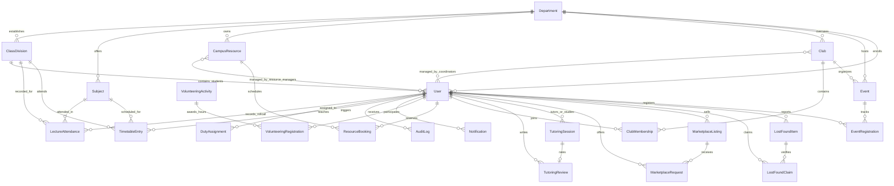

# CampusSync — Smart Campus Management & Community Platform

> **Tagline:** *One Campus. Everything in Sync.*  
> **Official Title:** *CampusSync — Smart Campus Management & Community Platform*

CampusSync is a production-grade, centralized digital ecosystem engineered for higher education institutions. Built on the modern MERN stack, it seamlessly unifies students, faculty, club coordinators, resource managers, and campus administrators into one synchronized platform for academic timetabling, roll-call attendance, club management, campus facility reservations, community service volunteering, peer marketplaces, tutoring, and lost-and-found recovery.

---

## 1. System Architecture & Entity Relationship Diagram

### 1.1 Technology Stack

| Layer | Technologies |
| :--- | :--- |
| **Frontend** | React 18, Vite, Material UI (MUI v5/v6), Emotion, React Router v6, Axios, Recharts, Socket.IO Client |
| **Backend** | Node.js, Express.js (ES Modules), Socket.IO, Multer, Helmet, Morgan, Express Rate Limit, Zod |
| **Database** | MongoDB with Mongoose ODM (26 normalized schemas with compound indexes & validation) |
| **Authentication & RBAC** | JWT (JSON Web Tokens), bcryptjs password hashing, server-enforced role determination, scoped authorization |
| **Testing** | Vitest, Supertest, React Testing Library, JSDOM (100% test pass rate across backend & frontend) |
| **Deployment** | Vercel / Netlify (Frontend SPA), Render / Railway / AWS (Backend Node API), MongoDB Atlas |

---

### 1.2 Mermaid Architecture & ER Diagram



---

## 2. Five Supported User Roles & Server-Enforced RBAC

CampusSync enforces strict, server-side Role-Based Access Control (RBAC). User roles and account statuses are **strictly determined from the trusted database record** on every request and are never trusted from the client.

| Role | Primary Scope & Authorized Responsibilities | Dedicated View / Dashboard |
| :--- | :--- | :--- |
| **Student** | Discover and register for campus events (with waitlists and PIN check-in), report lost/found items, file proof-of-ownership claims, trade textbooks/lab equipment on the peer marketplace, book peer tutoring, join student clubs, reserve permitted campus facilities, and log verified volunteering hours. | `/dashboard` (Student Portal) |
| **Faculty** | View personalized weekly timetable and chronological daily schedule, manage subjects and view student rosters, record lecture roll-call attendance with duplicate prevention, manage substitution and exam invigilation duties, supervise clubs and community service drives, approve volunteer hours, and publish official announcements. | `/dashboard` (Faculty Academic Hub) |
| **Club Coordinator** | Manage assigned student club profiles, review membership applications (Approve / Reject), assign committee roles (e.g. PR Lead, Treasurer, Tech Lead), host club hackathons/events with scoped club permission enforcement, and monitor member activity. | `/coordinator/dashboard` & `/clubs` |
| **Resource Manager** | Oversee assigned campus facilities (seminar halls, auditoriums, high-performance computing labs, projection kits), review booking reservation requests (Approve / Reject with anti-collision checks), configure availability, and manage maintenance status. | `/resource-manager/dashboard` & `/bookings` |
| **Campus Administrator** | Full platform governance: provision Staff accounts (Faculty, Club Coordinators, Resource Managers) with club and facility assignments, activate / suspend / deactivate user accounts, manage timetable allocations with real-time conflict detection, supervise compliance audit logs, and monitor campus-wide analytics. | `/admin` (Admin Portal) |

---

## 3. Authentication & Account Management Architecture

### 3.1 Unified Single Login
All 5 user roles authenticate through **one shared login page** (`/login`) using their official email and password.
- **No Client Role Selector**: Users never select their role during login.
- **Server-Determined Routing**: Upon successful authentication, the backend returns the authenticated user's trusted database record (`role`, `status`, `assignedClubs`, `assignedResources`). The frontend router automatically redirects the user to their designated dashboard:
  - `admin` $\rightarrow$ `/admin`
  - `coordinator` $\rightarrow$ `/coordinator/dashboard`
  - `resource_manager` $\rightarrow$ `/resource-manager/dashboard`
  - `faculty` $\rightarrow$ `/dashboard`
  - `student` $\rightarrow$ `/dashboard`
- **Show / Hide Password Control**: Password visibility toggle built directly into the login input for improved accessibility.
- **Dual-Domain Compatibility**: Seamlessly supports both `@campussync.edu` (new official branding) and legacy `@campussphere.edu` credentials for backwards compatibility.

### 3.2 Public Registration Guardrails
- **Student-Only Public Registration**: The public registration endpoint (`POST /api/auth/register`) strictly forces `role: 'student'`. Any attempt by a client to submit `role: 'admin'`, `role: 'faculty'`, etc., is ignored.
- **Administrative Provisioning for Privileged Roles**: Faculty, Club Coordinators, Resource Managers, and Administrators can only be provisioned by authenticated administrators via `POST /api/admin/staff` or `POST /api/admin/faculty`.

### 3.3 Account Status Lifecycle & Invalidation
- **Status Values**: `active`, `suspended`, `inactive`, `pending`.
- **Immediate Invalidation**: The authentication middleware (`server/middleware/auth.js`) inspects the user's status from the database on every authenticated request. Suspended, inactive, or pending accounts receive an immediate HTTP 403 response with a clear descriptive message, even if they hold a valid unexpired JWT token.
- **Last-Admin Safeguard**: The system prevents the last remaining active administrator from being suspended, deactivated, or deleted.

### 3.4 Scoped Permission Middleware
- **Resource Managers**: Can only review bookings (`PATCH /api/resources/bookings/:id/review`) and update resources (`PATCH /api/resources/:id`) for facilities to which they are explicitly assigned (`assignedResources` or `CampusResource.managers`). Requests for unassigned resources are rejected with HTTP 403 Forbidden.
- **Club Coordinators**: Can only review memberships, assign committee roles, and create events for clubs to which they are explicitly assigned (`assignedClubs`). Requests for unassigned clubs are rejected with HTTP 403 Forbidden.

---

## 4. Core Modules & Features

### 1. Unified Dashboards
- **Student Dashboard**: Quick access to active registrations, item claims, tutoring sessions, and volunteer hours.
- **Faculty Dashboard**: Live daily lecture schedule, upcoming invigilation duties, attendance KPI tiles, and one-click roll call.
- **Club Coordinator Dashboard**: Summary metrics for assigned clubs, active members, pending membership applications with quick review modal, and upcoming club events.
- **Resource Manager Dashboard**: Assigned facilities count, pending booking requests with approval modal, upcoming reservations, and facility maintenance status controls.
- **Admin Portal**: User Directory with status chips, assigned club/facility badges, Staff Provisioning dialog, and Account Edit modal with password reset capability.

### 2. Timetable Management & Conflict Guard (`/timetable`)
- Real-time server-side conflict detection engine guarding against:
  - Faculty double-booking across different classes.
  - Room / Laboratory physical collisions.
  - Student cohort scheduling overlaps.

### 3. Lecture Attendance Roll-Call & History (`/faculty/attendance`, `/faculty/attendance-history`)
- **Roll-Call**: Present, Late, Absent, with automatic duplicate session prevention.
- **Session-Level History**: Filterable by subject, cohort, date range, topic, and submission status.
- **Student Reports**: Calculates individual attendance percentages with institutional Late policies (0.5 credit standard) and chronological date-wise histories.
- **Controlled Audit Trail**: Authorized corrections with previous/new status tracking and permanent audit logging (`editHistory`).

### 4. Campus Events & PIN Check-In (`/events`)
- Atomic capacity limits with automated waitlist queueing and auto-promotion upon cancellation.
- 6-character verification PIN codes for on-site attendance verification.

### 5. Campus Facility Bookings (`/bookings`)
- Seminar halls, conference centers, engineering labs, and projection equipment.
- Conflict detection preventing double-booking of physical resources.

### 6. Student Marketplace (`/marketplace`) & Peer Tutoring (`/tutoring`)
- Book and equipment exchanges with negotiation threads.
- Verified peer tutoring slots with anti-double-booking guardrails and verified review submissions.

### 7. Volunteering & Community Service (`/volunteering`)
- Verified service drives with supervisor hour approvals and verifiable PDF/printable certificates.

---

## 5. Demonstration Accounts for Instant Testing

The database seeding script pre-populates official demonstration accounts for all 5 roles:

| Role | Email | Password | Primary Scenarios to Test |
| :--- | :--- | :--- | :--- |
| **Student** | `student@campussync.edu` | `Student@123` | Event registration, PIN check-in, Marketplace listing, Tutoring request, Volunteering records |
| **Student 2** | `student2@campussync.edu` | `Student@123` | Peer counterparty for marketplace offers, peer tutoring sessions |
| **Faculty** | `faculty@campussync.edu` | `Faculty@123` | Weekly timetable, lecture roll-call attendance, exam & substitution duties, volunteer approvals |
| **Club Coordinator** | `coordinator@campussync.edu` | `Coordinator@123` | Coordinator dashboard, review membership applications, assign committee roles |
| **Resource Manager** | `resourcemanager@campussync.edu` | `Manager@123` | Resource Manager dashboard, review booking reservations, facility maintenance mode |
| **Campus Admin** | `admin@campussync.edu` | `Admin@123` | Admin Portal, provision staff accounts, assign clubs/resources, suspend/edit users |

> *Tip: On both the Landing page and Login page (`/login`), you can click the **1-Click Demo Buttons** to instantly populate credentials for any role.*

---

## 6. Local Setup & Installation

### Prerequisites
- **Node.js**: v18.0.0 or higher (v20+ recommended)
- **MongoDB**: Local MongoDB instance running on port 27017 or a MongoDB Atlas URI
- **Git**

### Step 1: Clone and Install
```bash
git clone https://github.com/your-username/CampusSync.git
cd CampusSync

# Install root, server, and client dependencies concurrently:
npm run install:all
```

### Step 2: Configure Environment Variables
Copy `.env.example` in both `server/` and `client/`:

```bash
# Server configuration (server/.env)
PORT=5000
NODE_ENV=development
CLIENT_URL=http://localhost:5173
MONGODB_URI=mongodb://127.0.0.1:27017/campussync
JWT_SECRET=your_jwt_secret_minimum_32_characters_long_placeholder
JWT_EXPIRES_IN=7d
UPLOAD_DIR=uploads
MAX_FILE_SIZE_MB=5
ALLOWED_EMAIL_DOMAIN=campussync.edu
REQUIRE_CAMPUS_EMAIL=false

# Client configuration (client/.env)
VITE_API_URL=/api
```

### Step 3: Seed Demonstration Data
Run the seeding script to initialize departments, sample courses, resources, clubs, and demo accounts:
```bash
npm run seed
```

### Step 4: Run Development Servers
```bash
# Concurrently starts Express API (Port 5000) and Vite frontend (Port 5173):
npm run dev
```
Open **`http://localhost:5173`** in your browser.

---

## 7. Automated Testing & Verification

CampusSync includes full-coverage integration and component test suites:

```bash
# Run all tests (both backend integration and client tests):
npm run test:all

# Run backend API & RBAC tests (Vitest + Supertest):
npm test

# Run frontend component & routing tests (Vitest + React Testing Library):
npm run test:client

# Run production frontend bundle build:
npm run build
```

### Test Suite Summary
- **Backend**: 6 test files, **75 passing integration tests**:
  - `roleAuthManagement.test.js`: 17 tests verifying 5-role authentication, unassigned resource/club rejection, admin staff provisioning, and status suspension.
  - `attendanceIntegration.test.js`: 9 tests verifying attendance submission-to-history persistence.
  - `attendanceSystem.test.js`: 16 tests verifying roll-call validation, duplicate checks, and reporting.
  - `facultyManagement.test.js`: 13 tests verifying faculty provisioning and duty assignments.
  - `api.test.js`: 18 tests verifying events, marketplace, tutoring, and analytics.
  - `attendance.test.js`: 2 tests verifying input validation.
- **Frontend**: 2 passing component & routing tests validating CampusSync branding and multi-role demo access.

---

## 8. Health Check & API Reference

### Health Check Endpoint
- **`GET /api/health`**  
  Returns system status, MongoDB connection state, uptime, and official branding:
  ```json
  {
    "status": "ok",
    "service": "CampusSync API",
    "tagline": "One Campus. Everything in Sync.",
    "timestamp": "2026-10-24T13:30:00.000Z",
    "uptime": 120.45,
    "database": {
      "connected": true,
      "state": "connected"
    }
  }
  ```

### Selected Core API Endpoints

#### Authentication & Profiles
- `POST /api/auth/login` — Shared login for all 5 roles (email & password). Returns server-stored role and status.
- `POST /api/auth/register` — Public student registration (strictly restricted to `role: student`).
- `GET /api/auth/me` — Fetches current authenticated user profile, assigned clubs, and assigned resources.

#### Dashboards
- `GET /api/dashboard` — Role-specific metrics for students and faculty.
- `GET /api/dashboard/coordinator` — Assigned club metrics, member counts, and pending applications.
- `GET /api/dashboard/resource-manager` — Assigned facility metrics, pending booking requests, and maintenance counts.

#### Staff & Account Administration (Admin Only)
- `GET /api/admin/users` — Directory of all campus accounts with role and status filters.
- `POST /api/admin/staff` — Provisions Faculty, Club Coordinator, or Resource Manager accounts with assigned clubs/resources.
- `PUT /api/admin/staff/:id` — Updates staff profile, designations, and synchronizes club/resource assignments.
- `PATCH /api/admin/users/:id` — Activates, suspends, or deactivates accounts with last-admin safeguards.

#### Resources & Facilities
- `GET /api/resources` — List campus halls, labs, and equipment.
- `POST /api/resources/book` — Submits reservation request with schedule conflict detection.
- `PATCH /api/resources/bookings/:id/review` — Approves or rejects booking requests (enforces assignment scoping for Resource Managers).
- `PATCH /api/resources/:id` — Updates facility availability or maintenance status (enforces assignment scoping).

#### Clubs & Organizations
- `GET /api/clubs` — List campus clubs and societies.
- `POST /api/clubs/:id/apply` — Student membership application.
- `PATCH /api/clubs/memberships/:membershipId` — Approves or rejects membership (enforces assignment scoping for Club Coordinators).
- `POST /api/events` — Publishes event (enforces assigned club scoping for Club Coordinators).

---

## 9. Production Deployment Readiness

### Production Checklist
1. **Environment Variables**:
   - Ensure `NODE_ENV=production` in server environment.
   - Configure unique, high-entropy `JWT_SECRET` (minimum 32 characters).
   - Set `CLIENT_URL` to the deployed frontend domain (e.g. `https://campussync.institution.edu`) to enforce strict production CORS.
   - Set `MONGODB_URI` pointing to MongoDB Atlas or production replica set.
   - In frontend, set `VITE_API_URL` to `/api` (if using reverse proxy) or `https://api.campussync.institution.edu/api`.
2. **Reverse Proxy / Static Serving**:
   - The Express backend (`server/server.js`) includes static file serving for `client/dist` when hosted as a monolithic container, with client-side SPA routing fallback.
3. **Database Security**:
   - MongoDB user credentials should have least-privilege access restricted to the `campussync` database.
   - Production connection uses TLS/SSL (`ssl=true`).
4. **File Storage**:
   - Configurable for local disk or Cloudinary for cloud-persistent media storage.

---

## 10. License & Academic Attribution
Developed as an enterprise-grade full-stack smart campus management platform for higher education institutions.  
MIT Licensed. © 2026 CampusSync Team.
